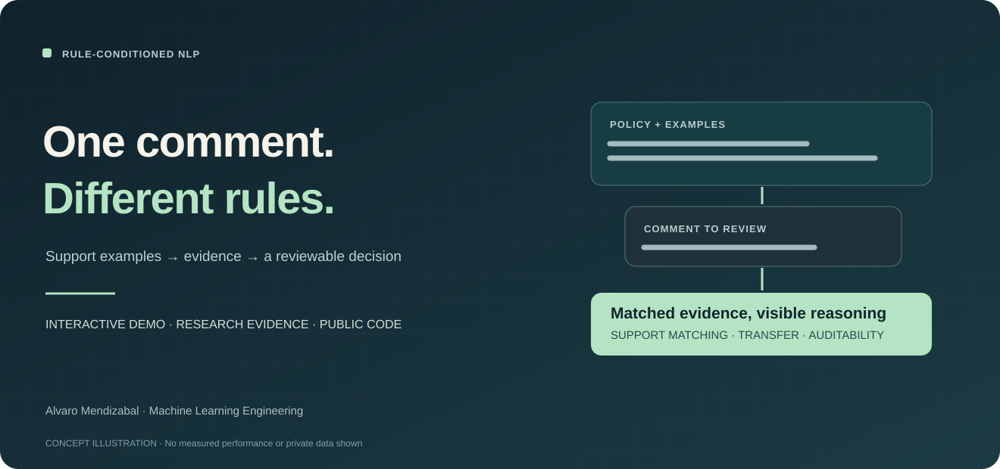
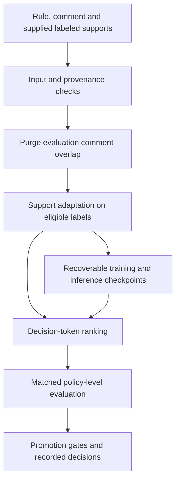

# Jigsaw · Rule-conditioned NLP

**One comment. Different rules. Explicit evidence.**

[](https://github.com/alvaromendizabal/jigsaw-rule-classifier/actions/workflows/quality.yml)
[](https://github.com/alvaromendizabal/jigsaw-rule-classifier/actions/workflows/public-demo.yml)



[**Open Policy Lens ↗**](https://alvaro-policy-lens.tartmacaw2.chatgpt.site) · [Case study](CASE_STUDY.md) · [Executed project review](notebooks/31_complete_project_review.ipynb) · [Run and verify](docs/REPRODUCIBILITY.md)

I built a system that ranks whether a comment violates a supplied community rule. My work covers support-adapted Qwen models, query/support overlap purging, whole-policy evaluation, multi-backbone research and recoverable AWS execution.

**Recorded late evaluation: 0.91808 public / 0.91425 private ROC AUC**, an absolute **+0.29469 private AUC** improvement over the project's lexical baseline. A matched-backbone study separately isolated the benefit of support adaptation. [Scored receipt](reports/checkpoints/kaggle_adaptation.json)

## Inspect the work

| Question | Best starting point |
|---|---|
| How does the supplied rule change prediction? | [Formatting and context](src/jigsaw_rules/formatting.py) and [formatting tests](tests/test_formatting.py) |
| How is query/support leakage prevented? | [Split logic](src/jigsaw_rules/splits.py), [validation notebook](notebooks/01_data_and_validation.ipynb) and [split tests](tests/test_splits_model.py) |
| What did adaptation add with the backbone held fixed? | [Matched study receipt](reports/checkpoints/support_adaptation.json) and [case study](CASE_STUDY.md) |
| What makes execution recoverable? | [Runtime layer](src/jigsaw_rules/runtime.py) and [pipeline tests](tests/test_runtime_pipeline.py) |
| Can I reproduce an actual output? | The public review and browser-export replay commands below |

## Run a verified public review

With Python 3.11+ and Node.js 22 or 24:

```bash
python3 -S review/run.py --output /tmp/jigsaw-review --with-node
python3 -S review/run.py --output /tmp/jigsaw-review --with-node --check
```

Open `/tmp/jigsaw-review/index.html`. The bundle records actual command results, source hashes, runtime and elapsed times. It exercises the public engine and its visible diagnostic challenges. On Windows, choose a writable directory outside the checkout. Omit `--with-node` for the smaller static-publication check.

The command requires no Python package installation, neural weights, cloud account or competition data. The [locked Python environment](docs/REPRODUCIBILITY.md) supports aggregate notebook execution and the broader research checks.

## Try Policy Lens

```bash
python -m http.server 8000
```

Open `http://localhost:8000/public-demo/`. Edit the rule, comment and allowed/violation examples. Compare one comment across three fictional policies, inspect matching terms and support examples, and download the computed result.

The browser fits TF–IDF on supplied examples only. Exact query/support duplicates are purged; contradictory examples fail explicitly. Its signed similarity margin is **not a probability**. This lightweight authored-text demonstration illustrates the system's input and evidence contracts without loading the historical Qwen model.

### Replay your exported analysis

```bash
node tools/replay_public_demo.mjs --input policy-lens-local-analysis.json --output /tmp/policy-replay
node tools/replay_public_demo.mjs --output /tmp/policy-replay --check
```

Replay recomputes every policy result, support contribution, margin, abstention and validation error using the actual public engine. It rejects fabricated outputs, mismatched sources and incomplete exports. Omit `--input` to generate the fictional reference example. [Replay contract and tolerances](docs/DEMO_REPLAY.md)

## System design



Whole-policy evaluation tests transfer to a different rule. Purging removes query bodies from fitted and support sources. Query targets stay outside GPU feature/inference inputs. Recorded late scores, matched development comparisons and the public lexical demo have separate evidence scopes. [Validation design](docs/VALIDATION.md)

## Results with their measurement scope

| Measurement | Result | What it establishes |
|---|---:|---|
| Successful late evaluation | **0.91808 public / 0.91425 private ROC AUC** | Performance of the retained scored system; not original competition placement |
| Matched support adaptation | **0.614600 → 0.719893** policy-macro AUC | Same 4B backbone and 881-comment cohort; isolates adaptation more directly |
| Feature-transfer campaign | **0.7989 familiar-policy / 0.5515 held-out-policy AUC** | Exposed poor policy transfer across 323 fits |
| Five-backbone development candidate | **0.740351** policy-macro AUC | Development evidence, separate from the official score |
| Visible lexical challenges | **16 of 24** expected outcomes; **8 misses retained** | Authored diagnostics of this demo; no production-accuracy estimate |

[Scored receipt](reports/checkpoints/kaggle_adaptation.json) · [Executed review](notebooks/31_complete_project_review.ipynb) · [Five-model study](notebooks/29_five_model_frontier_review.ipynb) · [Challenge report](reports/public_challenges.html)

Teacher-transfer and reciprocal-learning studies did not clear their registered promotion gates. Those negative results remain in the research record. The repeatedly inspected 881-comment/two-policy cohort is exploratory development, not an untouched holdout. The [model card](MODEL_CARD.md) describes the deployment limitations.

## Repository map and release scope

| Location | Purpose |
|---|---|
| `public-demo/`, `tools/` | Local lexical engine, input contracts, visible challenges and export replay |
| `src/jigsaw_rules/` | Data, validation, adaptation, inference and evaluation components |
| `scripts/`, `tests/` | Executable workflows and regression checks |
| `notebooks/`, `reports/` | Executed analyses, compact receipts and aggregate experiment evidence |
| `docs/`, `review/` | Design decisions, reproducibility and source-linked inspection |

Private comments, row-level predictions, weights, optimizer state, credentials and exact private ensemble construction remain excluded. The public release supports runnable components and aggregate evidence; a complete private-model retraining requires separately retained artifacts. Historical source, receipts and licenses are retained because they are part of the tested evidence path. [Source credits](docs/TOP_SOLUTION_INTEGRATION.md) · [Closeout](docs/PROJECT_CLOSEOUT.md)
