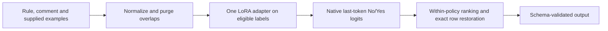

# Jigsaw · Rule-conditioned language models

**Alvaro Mendizabal · Applied NLP · Low-rank adaptation · Reliable ML systems**

[](https://github.com/alvaromendizabal/jigsaw-rule-classifier/actions/workflows/quality.yml)
[](https://github.com/alvaromendizabal/jigsaw-rule-classifier/actions/workflows/public-demo.yml)


I built a support-adapted language-model classifier for rules that change between communities, with explicit query/support leakage controls and recoverable training and inference. The retained system is **Qwen3-4B-Instruct-2507 + LoRA**, using original training labels and supplied positive/negative policy examples—not hidden query targets.

**Recorded result: 0.91808 public / 0.91425 private ROC AUC.** These are historical post-competition scores, not a new result from the public demo. [Original receipt](reports/checkpoints/kaggle_adaptation.json)

[**Explore Policy Lens ↗**](https://alvaro-policy-lens.tartmacaw2.chatgpt.site) · [Case study](CASE_STUDY.md) · [Reproduce components](docs/REPRODUCIBILITY.md) · [Model card](MODEL_CARD.md)

## The final system



| Engineering decision | Inspect the implementation | Verification |
|---|---|---|
| Keep query targets out of adaptation | [Support construction](scripts/competition_features.py) and [adaptation inputs](scripts/kaggle_adaptation.py) | [Label-flip and overlap tests](tests/test_kaggle_adaptation.py) |
| Adapt the actual causal language model | [LoRA and decision prompts](scripts/support_adaptation.py) | [Native model and last-token parity](tests/test_support_adaptation.py) |
| Recover training without silently restarting | [Optimizer, scheduler, scaler and RNG state](scripts/decision_training.py) | [Exact-resume and overflow tests](tests/test_decision_training.py) |
| Separate ranking from calibration | [Policy ranks and prediction cache](scripts/kaggle_adaptation.py) | Extreme logits, original IDs and corrupt-cache rejection |
| Package canonical code for offline use | [Notebook builder](scripts/build_adapted_notebook.py) | [Exact embedded-source contract](tests/test_kaggle_adaptation.py) |

## What the evidence supports

| Comparison | Recorded result | Population |
|---|---:|---|
| Retained support-adapted model | **0.91425 private AUC** | Historical external evaluation |
| Matched frozen → adapted backbone | **0.61460 → 0.71989** | 881 novel comments, two previously examined policies |
| Matched adaptation gain | **+0.10529 AUC** | Equal-weight policy-macro AUC, not pooled AUC |

The matched study isolates adaptation on the same backbone; the external comparison also changes the model and input method. Neither the repeatedly inspected development cohort nor the visible demo challenge is an untouched generalization test. [Validation scope](docs/VALIDATION.md)

## Run something real from a clone

The source-linked review needs only Python 3.11+; Node.js 22 or 24 enables the actual browser-engine checks:

```bash
python3 -S scripts/review_portfolio.py --json
python3 -S review/run.py --output /tmp/jigsaw-review --with-node
python3 -S review/run.py --output /tmp/jigsaw-review --with-node --check
```

For the **trainable CPU control**, use Python 3.12 and the locked environment:

```bash
uv sync --locked --group dev
uv run jigsaw demo --root /tmp/jigsaw-cpu-demo
uv run jigsaw demo --root /tmp/jigsaw-cpu-demo
uv run jigsaw review --root /tmp/jigsaw-cpu-demo --allow-synthetic
```

This fits and evaluates the TF-IDF/logistic-regression control on authored data; the second run verifies and reuses completed stages. It is not a substitute for the retained neural result. [Full setup and native miniature-model tests](docs/REPRODUCIBILITY.md)

## Interactive failure analysis

Policy Lens recomputes a fitted lexical reference as the rule, examples and comment change. It exposes signed feature contributions, overlapping support and conflicting labels. The **24 visible authored challenges include 16 expected outcomes and eight misses**; every failure remains in the published diagnostics. [Challenge report](docs/PUBLIC_CHALLENGES.md) · [Replay an exported decision](docs/DEMO_REPLAY.md)

## Publication boundary

The maintained tree contains the final adaptation/training/inference components, their control, tests, compact original evidence and public demonstration. Abandoned feature banks, alternate-backbone campaigns, teacher studies, redundant notebooks and operator launchers are retired. The historical metadata may describe discarded comparisons, but their implementations are not presented as current capabilities.

Private comments, weights, adapters, cached representations and full inference outputs are excluded. The [offline notebook](kaggle/submission.ipynb) is generated from the retained canonical source and requires separately licensed data, pretrained weights and a suitable GPU. Public checks exercise native miniature Qwen/LoRA behavior; they do not retrain the historical 4B system or reproduce its score.

[Data card](DATA_CARD.md) · [Source credits](docs/TOP_SOLUTION_INTEGRATION.md) · [License](LICENSE)
